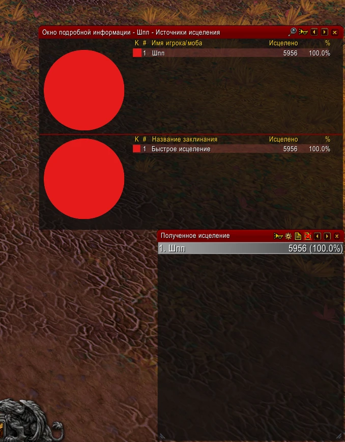
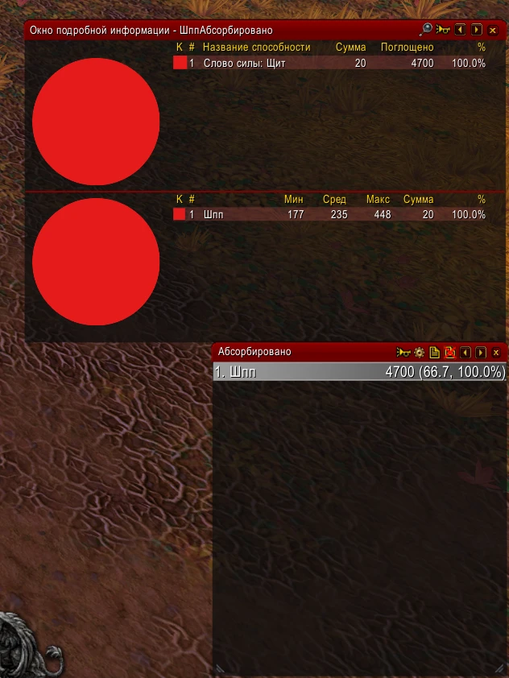

Дополнение для Recount 3.3.5a. RecountGuessedAbsorbs - это дополнение создано для владельцев валанира и жрецов в специализации "Послушание", показывая их поглощение урона (только поглощение, без исцеления). С новым Recount аддон отключается сам: поглощение щитов показывает штатный режим Recount «Поглощение».

**Скриншоты:**

